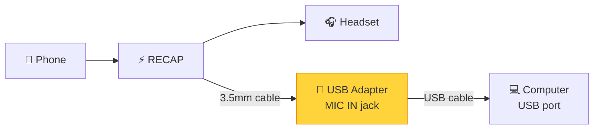

## The 5-Minute Diagnostic

**Use this flowchart to diagnose any problem with your recording.**

Run tests IN ORDER. Don't skip steps.

> ⚠️ **Wrong page if your problem is the live call.** This flowchart diagnoses what lands in your *recording*. If your callers say you sound muffled or distant **while you're talking**, none of these tests will help — you can pass all five and still have the problem. Go to [Callers Say I Sound Muffled or Distant](far-end-audio.md) instead.

### Diagnostic Flowchart

```mermaid
flowchart TD
    Start([Having problems with RECAP?<br/>Start here]) --> Test1{Test 1: Direct Headset Test<br/><br/>Plug headset into phone<br/>Make test call<br/><br/>Can you hear them?<br/>Is the wired headset mic active?}

    Test1 -->|NO to either| BadHeadset[Check direct headset path<br/><br/>Check headset mic, adapter<br/>and app routing before<br/>adding RECAP]

    Test1 -->|YES to both| Test2{Test 2: Pass-Through Test<br/><br/>Connect Phone → RECAP → Headset<br/>Make test call<br/><br/>Can you hear call<br/>in your headset?}

    Test2 -->|NO| TryHeadset[Compare direct baseline<br/>and RECAP chain<br/><br/>Check connections and routing<br/>No cause established yet]

    Test2 -->|YES| Test3{Test 3: Device Scanner<br/><br/>Visit: recapmycalls.com/audio/<br/>Take screenshot<br/><br/>STEREO or MONO input?}

    Test3 -->|MONO| USBAdapter[Check selected input<br/>and capture mode<br/><br/>If external input is confirmed mono,<br/>use a stereo mic input/interface<br/><br/>Scan does not establish<br/>unit condition]

    Test3 -->|STEREO| Test3B{Test 3B: Check Device Settings<br/><br/>Click device to expand details<br/><br/>Echo Cancellation OFF?<br/>Noise Suppression OFF?<br/>Auto Gain Control OFF?}

    Test3B -->|Features ON| FixInterference[⚠️ Disable Interference<br/><br/>Turn OFF these features:<br/>• Echo Cancellation<br/>• Noise Suppression<br/>• Auto Gain Control<br/><br/>These can merge or kill channels!]

    Test3B -->|All OFF| Test3C{Test 3C: Baseline Test<br/><br/>Test with standard<br/>stereo microphone<br/><br/>Independent left/right<br/>responses confirmed?}

    Test3C -->|NO| FixBaseline[⚠️ Fix Computer Setup<br/><br/>Baseline stereo test failed.<br/>Check input and recording mode.<br/><br/>Check:<br/>• Using MIC IN port not LINE IN<br/>• Recording software set to STEREO<br/>• Correct input device selected]

    Test3C -->|YES or No stereo mic| Test4{Test 4: Audio Input Gain<br/><br/>Windows: Recording devices<br/>→ Microphone → Properties<br/>→ Levels → Set to 100%<br/><br/>Mac: System Preferences<br/>→ Sound → Input<br/>→ Drag slider right<br/><br/>Alternating test phrases:<br/>corresponding channels moving?}

    FixInterference --> Test3C
    FixBaseline --> Test4

    Test4 -->|NO movement| FixGain[✅ Increase gain to 100%<br/><br/>Retest both channels<br/><br/>Also check: correct<br/>input device selected?]

    Test4 -->|YES| Test5{Test 5: Recording Software<br/><br/>Correct mic selected?<br/>STEREO mode enabled?<br/><br/>Alternate participant phrases<br/>Check each recorded channel}

    Test5 -->|Problems| FixSoftware[✅ Check settings:<br/><br/>- Select External Mic/RECAP<br/>- Enable STEREO recording<br/>- Close apps using mic]

    Test5 -->|Works| Success[✅ Success!<br/><br/>Both voices captured<br/>on separate channels<br/>in this tested setup]

    FixGain --> Retest1[Retest recording]
    FixSoftware --> Retest1
    USBAdapter --> Test4
    Retest1 --> StillBroken{Still not working?}
    StillBroken -->|YES| ContactSupport[📧 Contact Support<br/><br/>Include results from<br/>all 5 tests above]
    StillBroken -->|NO| Success

    style BadHeadset fill:#ff6b6b,stroke:#c92a2a,color:#fff
    style TryHeadset fill:#ff6b6b,stroke:#c92a2a,color:#fff
    style USBAdapter fill:#ffd43b,stroke:#f08c00,color:#000
    style FixInterference fill:#ffd43b,stroke:#f08c00,color:#000
    style FixBaseline fill:#ffd43b,stroke:#f08c00,color:#000
    style FixGain fill:#ffd43b,stroke:#f08c00,color:#000
    style FixSoftware fill:#ffd43b,stroke:#f08c00,color:#000
    style Success fill:#51cf66,stroke:#2f9e44,color:#fff
    style ContactSupport fill:#748ffc,stroke:#4c6ef5,color:#fff
    style Start fill:#e7f5ff,stroke:#339af0,color:#000
```

**How to use this flowchart:**

1. Start at the top
2. Follow each test in order
3. Yellow boxes = Action needed (fix something)
4. Green box = Success!
5. Red boxes = Stop and get different equipment

---

## Test 3B: Checking Device Settings (Critical!)

**After scanner shows STEREO, don't celebrate yet!** Modern audio devices have "enhancement" features that can interfere with RECAP.

### How to Check Device Settings

1. On the scanner page, **click on the device name** (e.g., "Microphone (Realtek Audio)")
2. The device card will expand to show detailed settings
3. Look for these features and their status:

**Interference Features (should be OFF):**

- **Echo Cancellation** - Designed to remove echo, but may suppress one channel thinking it's an echo
- **Noise Suppression** - Filters background noise, but can kill quiet voices or merge channels
- **Auto Gain Control (AGC)** - Automatically adjusts volume, but may apply different gain to each channel

**Common problems when these are ON:**

- One-sided recording (only hear yourself OR only hear them)
- Merged channels (both sides mixed into mono)
- Inconsistent volume levels
- Audio dropouts or distortion

### How to Fix Interference

**Option 1: Via Audio Scanner (if supported)**

- Use the toggle switches in the expanded device view
- Turn OFF Echo Cancellation, Noise Suppression, and Auto Gain Control
- Adjust gain sliders to desired level (usually 80-100%)

**Option 2: Via Operating System Settings**

**Windows:**

1. Right-click speaker icon → "Sounds"
2. Go to "Recording" tab
3. Select the device → "Properties"
4. **Enhancements tab** → Check "Disable all enhancements" OR uncheck specific features
5. **Levels tab** → Set microphone to 80-100%
6. Click OK

**Mac:**

1. System Preferences → Sound → Input
2. Select the device
3. **Note:** Mac has fewer audio processing options than Windows
4. If issues persist, check the selected external input, gain and processing with the two-sided test before considering an interface change

### Using the VU Meters

While on the scanner page with device expanded:

1. Make a short test call with REC capturing the connected external stereo input.
2. Say a phrase into the headset mic while the other participant pauses; watch which channel responds.
3. Have the other participant say a different phrase while you pause; the other channel should respond.
4. **One channel moving during one participant's phrase is expected.** Both bars need not move together. Some crosstalk may appear; confirm each voice is captured mainly on its own channel by inspecting and playing back the separate channels.
5. If a participant's phrase is missing, or both channels carry the same mix, check input selection, stereo/mono mode, headset/app routing and processing. The meter pattern is a clue, not a diagnosis of interference, adapter failure or unit condition. Follow the [two-sided test](../using-recap/making-calls.md#setup-and-two-sided-test).

---

## Test 3C: Baseline Stereo Test (Critical!)

**Before troubleshooting RECAP further, verify your computer can record stereo audio at all.**

Many customers have NEVER successfully recorded stereo audio on their computer before using RECAP. If the computer/software isn't configured correctly, RECAP won't work either.

### Why This Test Matters

**What this checks:** whether the same external recording input can capture two channels independently of the RECAP call chain. It does not establish the condition of the RECAP unit.

**Common issues this catches:**
- RECAP plugged into a line-only input rather than the supported stereo MIC setup
- Recording software defaulting to MONO mode
- Wrong port selected in recording software
- Computer genuinely lacks stereo capability (scanner false positive)

### How to Perform Baseline Test

**You'll need:** A verified two-channel stereo microphone connected to the same physical external input

**Test procedure:**

1. **Unplug RECAP temporarily**
2. **Plug in a stereo microphone** to the same port you were using for RECAP
3. **Open your recording software** (Audacity, Sound Recorder, etc.)
4. **Set recording mode to STEREO** (not mono!) - this is critical
5. **Test each channel separately**, following the microphone manufacturer's channel-check instructions. Present a sound close to one capsule/input at a time, then the other, while watching separate left/right recording meters or waveforms. Each stimulus must produce a different left/right response.
6. **Inspect both channels and play them back separately.** A stereo file containing the same signal duplicated into both channels is not a pass. If you cannot distinguish independent channel responses, the baseline remains unverified.

### What Qualifies as a Stereo Microphone?

Use a microphone whose manufacturer confirms **two-channel stereo capture** through
that same external input. Stereo headphones can have a **mono** headset microphone;
phone earbuds and gaming headsets do not establish a stereo recording baseline.
A built-in or USB microphone tests a different input and cannot validate the jack
RECAP uses.

**Don't have a stereo mic?** Continue to Test 4 and use the [two-sided RECAP test](../using-recap/making-calls.md#setup-and-two-sided-test). If it fails, contact support with the result; do not buy another microphone solely to complete this baseline.

### Interpreting Results

**✅ Baseline test PASSED (independent left/right responses confirmed):**
- Your computer CAN record stereo
- Your recording software is configured correctly
- The tested input captured the two-channel stimulus; this does not measure its voltage or validate RECAP's electrical interface
- **Conclusion:** The external input captured the baseline. Next isolate the complete RECAP call path; this result alone does not identify a cause.
- **Next step:** Continue to Test 4

**❌ Baseline test FAILED (stereo mic did NOT record):**
- **The baseline did not capture stereo.** Check the selected input, test microphone and recording mode before interpreting the RECAP test
- **Common causes:**
  - Using LINE IN port instead of MIC IN port
  - Recording software set to MONO mode
  - Wrong input device selected in software
  - Gain set to 0%
  - Scanner incorrectly reported STEREO (actually MONO)
- **Next step:** Fix computer setup BEFORE trying RECAP again

### How to Fix Failed Baseline

If baseline test failed, fix these issues:

**Check port type:**
- Pink jack = MIC IN ✅ (correct)
- Blue jack often indicates LINE IN; confirm the actual input specification
- Green jack = Speaker/Headphone OUT ❌ (wrong)

**Check recording software:**
- Audacity: Audio Setup → Recording Channels → **2 (Stereo)**
- Sound Recorder (Windows): Should auto-detect, but check input device selection
- QuickTime (Mac): File → New Audio Recording → Click dropdown next to record button → Select stereo device

**Check input device:**
- Recording software must select the correct device
- Don't use "Default" - explicitly select the stereo-capable device
- If using USB adapter, select "USB Audio Device" not "Realtek"

**Check gain:**
- Windows: Sounds → Recording → Device → Properties → Levels → 80-100%
- Mac: System Preferences → Sound → Input → Input volume slider to right

---

## The USB Adapter Solution

### When You Need It

**Consider an interface only after checking the actual recording input:**

- A scanner MONO report is a clue: confirm the selected physical external input and capture mode first.
- If that input is confirmed mono, or there is no supported external stereo MIC input, use another compatible stereo MIC input/interface.
- A working headset pass-through with a failed recording does **not** by itself show an adapter is needed. Check routing, input selection, recording mode, gain and processing.
- Computer brand or age alone does not establish input capability. Use the [compatibility checklist](../getting-started/requirements.md#compatibility-checklist) and [two-sided test](../using-recap/making-calls.md#setup-and-two-sided-test).

### Why This Happens

**RECAP outputs stereo audio (2 channels):**

- One channel = Your voice
- Other channel = Their voice
- ⚠️ Channel assignment (L/R) may vary depending on USB adapter

**Your computer needs stereo input to record both channels.**

A confirmed mono capture cannot preserve S2's two separate recording channels. A one-sided recording can also result from input selection, routing, cabling, gain or processing; it does not identify a cause on its own.

Neither a scanner channel count nor a one-sided recording establishes the condition of the RECAP unit. Use controlled tests to isolate the affected path.

### The Solution: A USB Stereo Mic Adapter

If the existing input lacks the required capability, an interface with a verified
stereo microphone input can supply it. A USB connector or stereo headphone output
alone does not establish that capability.

**What it has to do — these are the criteria, not a brand:**

- ✅ **Stereo** microphone input (2 channels) — the one that matters most
- ✅ Supplies bias voltage (plug-in power) to the mic input
- ✅ Plug-and-play on your OS, no drivers

**Which specific models we currently recommend, and where to buy them, is on the
[compatible adapters guide](https://recapmycalls.com/compatible-adapters-for-recap/).**
That list is kept up to date as hardware and prices change — this manual
deliberately doesn't name models, so the two can't drift apart.

### How to Use USB Adapter

**Connections:**

**Setup steps:**

1. Plug USB adapter into computer's USB port
2. Connect RECAP's output to USB adapter's MIC IN jack
3. Computer will automatically recognize "USB Audio Device"
4. In recording software, select "USB Audio Device" as input
5. Test recording - should now capture both channels

**That's it!** The USB adapter gives your computer a true stereo microphone input.

### Checking Any Adapter Yourself

If the ones on the guide aren't available where you are, look for:

**Required features:**

- **Stereo microphone input** (2 channels) - most important
- Bias voltage for external microphones
- Specifications mention "stereo mic input" or "2-channel input"

**NOT compatible:**

- USB adapters with only LINE IN
- USB adapters with only MONO mic input (1 channel)
- Bluetooth adapters (too much latency for real-time)

---

