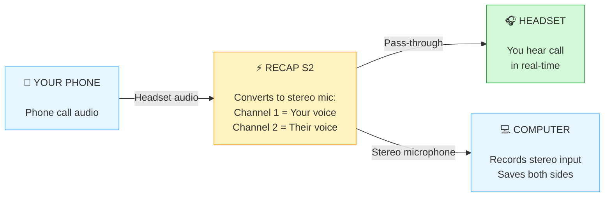

## How RECAP Works

### What RECAP Does

RECAP is a hardware audio converter. It sits between your phone and your headset, and it does two things at once:

1. **Passes call audio through to your headset** — so you can talk normally, as if RECAP wasn't there.
2. **Sends a separate recording output to your computer** — this is where both sides of the conversation are captured for recording.

These are two independent outputs. They carry different signals. Understanding this distinction is key to troubleshooting any audio issue.

**Audio flow:**

---

### Two Outputs, Two Different Signals

This is the most important thing to understand about RECAP. It has **two outputs** and they work completely differently:

#### Output 1: Pass-Through (Headset Jack)

The pass-through sends your phone's call audio straight to your headset. RECAP does not modify, split, or process this signal in any way. It is **identical** to plugging your headset directly into your phone.

- You hear the caller in **both ears**, same as without RECAP
- The caller hears you through the headset mic, same as without RECAP
- The audio is **mono** (same sound in left and right ear) — this is normal for phone calls
- If you unplugged the recording cable and never connected a computer, the pass-through would still work exactly the same

> **This assumes your headset has a microphone on the cable.** If it doesn't, your call device uses its own built-in microphone instead — so your caller hears you from wherever the phone is sitting, which can make you sound distant. If people tell you that you sound muffled, start here: [Callers Say I Sound Muffled or Distant](../troubleshooting/far-end-audio.md).

**Example:** You're on a call with a client. You hear their voice in both ears of your headset, they hear your voice through the headset mic. You talk normally. From a call quality perspective, nothing has changed — RECAP is invisible.

**If you only hear in one ear through the headset pass-through, that is not the recording split.** Compare the direct-headset baseline and complete chain to isolate the path; see [headset troubleshooting](../troubleshooting/no-audio.md#problem-only-hear-in-one-ear-headset).

> ⚠️ **If using a Lightning or USB-C adapter:** Always connect the headset to RECAP first, then plug into the phone last. Your phone performs accessory detection at plug-in — if the headset isn't already in the chain, audio may route incorrectly. See [Connection Order troubleshooting](../troubleshooting/low-volume-noise.md#problem-audio-routes-to-speaker-or-one-ear-with-lightningusb-c-adapter).

#### Output 2: Recording Output (MIC Jack)

This is the separate cable that goes from RECAP to your computer (or voice recorder). This output is where RECAP does its real work — it captures both sides of the conversation and splits them into a **stereo signal**:

- **One channel** = your voice (picked up from the headset mic)
- **The other channel** = the caller's voice (picked up from the phone's audio)

Which one your recording shows as **left** and which as **right** depends on your recording device. Some devices swap them, which is normal. If it matters to you, check with a short test recording ([Channel Swap](../troubleshooting/low-volume-noise.md#problem-left-and-right-channels-are-swapped)).

This stereo split is intentional. It's the whole point of RECAP — it gives you clean, separated audio that you can edit, transcribe, or process independently.

**Example:** You record a 30-minute interview. When you open the recording in Audacity or any audio editor, you see two channels. One channel is you, the other is the interviewee. You can adjust volume on each independently, remove background noise from one side without affecting the other, or export just the caller's audio.

⚠️ **The stereo split only exists on the recording output.** It has nothing to do with what you hear in your headset during the call.

---

### Setup and two-sided test

Check the [compatibility checklist](../getting-started/requirements.md#compatibility-checklist)
first. **CALL** is the phone/device running the call; **REC** is the separate recorder.

1. Test the wired TRRS headset directly on CALL with the same phone adapter and
   calling app. Confirm you hear the other person and they hear the **headset mic**.
   Move CALL away from your mouth and gently rub the headset's microphone housing
   while your test partner listens; compare with a gentle rub near CALL's built-in
   mic. The headset-mic sound should be prominent. If only the phone-mic sound is
   prominent, the wired mic route has not passed. Check the app's input/output route
   and repeat; Bluetooth, the phone speaker or built-in mic bypasses the intended
   wired path. An app permission alone does not prove routing.
2. Disconnect from CALL. Connect the headset to RECAP's **HEADSET** pass-through,
   and the included **3-pole TRS recording cable** from RECAP's **MIC/recording output**
   to REC's external stereo mic input. Connect RECAP to the phone adapter if needed,
   then connect the **CALL phone last**. See [connection order](../troubleshooting/low-volume-noise.md#problem-audio-routes-to-speaker-or-one-ear-with-lightningusb-c-adapter).
3. On REC, select that physical external input, **MIC mode** where selectable,
   plug-in power enabled where supported, and **stereo/two-channel** recording.
   Start with processing/mono mixing off. Follow the recorder's manual for controls.
4. Record a short call (about 20–30 seconds). Say a phrase while the other person
   pauses, then have them say a different phrase while you pause. Keep the call
   audible only in the headset, so REC's built-in mic cannot pick up speaker audio.
5. Stop and play back **both recorded channels**. Confirm both voices are audible
   at useful levels and each appears on its own channel. Note which side is yours;
   device/software channel labels can differ. Your voice alone does not prove the
   RECAP path is selected. A stereo setting alone does not prove two-sided capture.

Repeat when changing the phone, adapter, headset, recorder or calling app. For
missing recording audio use [No Audio Recorded](../troubleshooting/no-audio.md);
for what the caller hears use [live-call troubleshooting](../troubleshooting/far-end-audio.md).
If the documented setup still fails, [contact support](../support.md) with the
symptom and test result; the failure alone does not establish which part is at fault.

### Technical Details

| Connection | Interface |
|---|---|
| Phone plug / headset pass-through | 3.5 mm TRRS, AHJ/CTIA headset path |
| Recording output (MIC jack) | 3.5 mm TRS: Tip carries phone/caller audio, Ring carries headset-mic audio, Sleeve is common ground on reviewed v40 artwork |
| Recorder setup | External stereo MIC input, MIC mode and plug-in power where supported |

Both recording paths appear AC-coupled in the archived v40 artwork. Earlier bias-power,
impedance and voltage statements did not establish a validated interface specification;
see [the corrected requirements and pending validation](../getting-started/requirements.md#plug-in-power-and-voltage-validation-pending).
No batteries are required. Do not infer a safe interface voltage from a component
rating, or use 48 V phantom power. Use the two-sided test to establish the channel
assignment in your actual recording.

---
